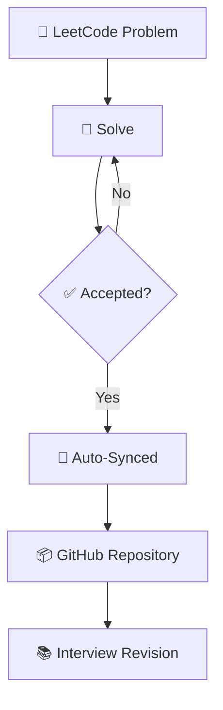

<div align="center">

# 🧩 LeetCode Solutions

### A structured, continuously-growing archive of accepted LeetCode solutions in Java

[](https://www.java.com/)
[](https://leetcode.com/)
[](https://github.com/)
[](#-topics-covered)
[](#-license)
[](#)

</div>

---

## 📖 Introduction

This repository is a personal, continuously updated archive of every **accepted** solution I write on LeetCode. The setup is complete and the sync pipeline is ready — each time a submission is accepted, it will automatically flow into this repository. No manual copy-pasting, no gaps, no skipped days.

This is the starting point of that journey. There are no solutions here yet, and that's intentional — this README documents the structure, conventions, and intent of the repository *before* the first problem is solved, so that consistency can be tracked from commit #1 onward.

Consistent, deliberate practice with Data Structures and Algorithms is one of the strongest predictors of interview performance at product-based and service-based companies alike. Rather than treating problem-solving as a one-off task before interviews, this repository is meant to treat it as an ongoing discipline — a running log of how my problem-solving ability, code quality, and pattern recognition evolve over time, right from day one.

More than a future solutions dump, this is intended to become:

- 📈 A visible record of consistency and long-term commitment
- 🧠 A revision vault for interview preparation
- 🗂️ A structured reference organized by problem and topic
- 🌱 A live snapshot of an ongoing DSA learning journey

---

## 🌳 Planned Repository Structure

Each problem will live in its own self-contained folder, numbered and named after the original LeetCode problem for easy lookup. No problem folders exist yet — this is the structure that will be populated as solutions are added.

```text
LeetCode-Solutions/
│
├── 0001-Two-Sum/                 <- to be added
│   ├── README.md
│   └── Solution.java
│
├── 0002-Add-Two-Numbers/         <- to be added
│   ├── README.md
│   └── Solution.java
│
├── ...
│
└── README.md
```

<details>
<summary>📁 Folder conventions (to be followed once solutions begin)</summary>

- Folders are named `<ProblemNumber>-<Problem-Title>` in kebab-case.
- Each folder will contain a `Solution.java` file with the accepted code.
- Each folder will contain its own `README.md` with problem summary, approach, and complexity analysis.
- Folder numbering is zero-padded (`0001`, `0042`, `1029`, ...) to preserve correct alphabetical/numerical sorting.

</details>

---

## ✨ Features

| Feature | Description |
|---|---|
| 🔄 **Auto-Sync** | Every accepted submission on LeetCode will automatically sync to this repository |
| ☕ **Java-First** | All solutions will be implemented in Java, following clean coding conventions |
| 🗂️ **Organized Structure** | One folder per problem — easy to browse, search, and reference |
| 🎯 **Interview-Ready** | Structured specifically for quick revision before interviews |
| 📅 **Consistency Tracking** | Commit history will double as a public log of daily/weekly practice |
| 🔍 **Easy Navigation** | Predictable naming will make any problem easy to locate instantly |
| 🕒 **Version History** | Full Git history for every solution — see how an approach evolves over time |

---

## ⚙️ Workflow



---

## 🎯 Goals

- 🚀 Improve problem-solving speed and accuracy from a clean slate
- 🧩 Build core Data Structures and Algorithms fundamentals
- 💼 Prepare thoroughly for technical interviews
- 📆 Establish and maintain daily/weekly coding consistency
- 📊 Track long-term learning progress through commit history
- 🧼 Develop clean, readable, and idiomatic coding habits from the very first solution

---

## 📚 Topics To Cover

<details open>
<summary><b>Click to expand / collapse topic checklist</b></summary>

| Topic | Status | Topic | Status |
|---|:---:|---|:---:|
| Arrays | ⬜ | Binary Search | ⬜ |
| Strings | ⬜ | Sliding Window | ⬜ |
| HashMap | ⬜ | Two Pointers | ⬜ |
| Stack | ⬜ | Backtracking | ⬜ |
| Queue | ⬜ | Recursion | ⬜ |
| Linked List | ⬜ | Bit Manipulation | ⬜ |
| Trees | ⬜ | Trie | ⬜ |
| BST | ⬜ | Math | ⬜ |
| Heap | ⬜ | Prefix Sum | ⬜ |
| Graph | ⬜ | Matrix | ⬜ |
| DFS | ⬜ | Simulation | ⬜ |
| BFS | ⬜ | Dynamic Programming | ⬜ |
| Greedy | ⬜ | | |

✅ = Solved at least one problem &nbsp;&nbsp;|&nbsp;&nbsp; ⬜ = Not started yet

</details>

---

## 💡 Why This Repository

> **A public repository is more than storage — it's proof of process.**

| Benefit | Impact |
|---|---|
| 🧠 **Learning** | Writing and re-reading solutions will reinforce core concepts |
| 🔁 **Revision** | A self-authored revision bank, built from the ground up |
| 💼 **Interview Prep** | Patterns across problems become easier to recognize with volume |
| 🎨 **Portfolio Building** | Demonstrates consistency and technical depth to recruiters over time |
| 📅 **Consistency** | Public commits will create accountability for daily practice |
| 🌐 **Open-Source Profile** | Strengthens overall GitHub activity and presence |

---

## 🛠️ Technologies

<div align="center">


</div>

---

## 🤝 Contribution

This repository is primarily maintained as a **personal learning archive**. That said, if you spot a bug, a more optimal approach, or an improvement to the documentation once solutions start appearing:

1. Open an issue describing the suggestion
2. Or submit a pull request with a clear explanation of the change

All constructive suggestions are welcome and appreciated. 🙌

---

## 📄 License

This project is licensed under the **MIT License**.

<details>
<summary>View License Summary</summary>

```
MIT License

Permission is hereby granted, free of charge, to any person obtaining a copy
of this software and associated documentation files, to deal in the Software
without restriction, including without limitation the rights to use, copy,
modify, merge, publish, distribute, sublicense, and/or sell copies of the
Software, subject to the inclusion of the above copyright notice in all
copies or substantial portions of the Software.

THE SOFTWARE IS PROVIDED "AS IS", WITHOUT WARRANTY OF ANY KIND, EXPRESS OR
IMPLIED, INCLUDING BUT NOT LIMITED TO THE WARRANTIES OF MERCHANTABILITY,
FITNESS FOR A PARTICULAR PURPOSE AND NONINFRINGEMENT.
```

</details>

---

<div align="center">

### 🌱 "Every archive starts with an empty folder — this one starts today."

⭐ Follow along as this repository fills up, one accepted solution at a time.

</div>

<!---LeetCode Topics Start-->
# LeetCode Topics
## Array
|  |
| ------- |
| [0001-two-sum](https://github.com/Guruvesh03/Leetcode-Solutions/tree/master/0001-two-sum) |
## Hash Table
|  |
| ------- |
| [0001-two-sum](https://github.com/Guruvesh03/Leetcode-Solutions/tree/master/0001-two-sum) |
<!---LeetCode Topics End-->